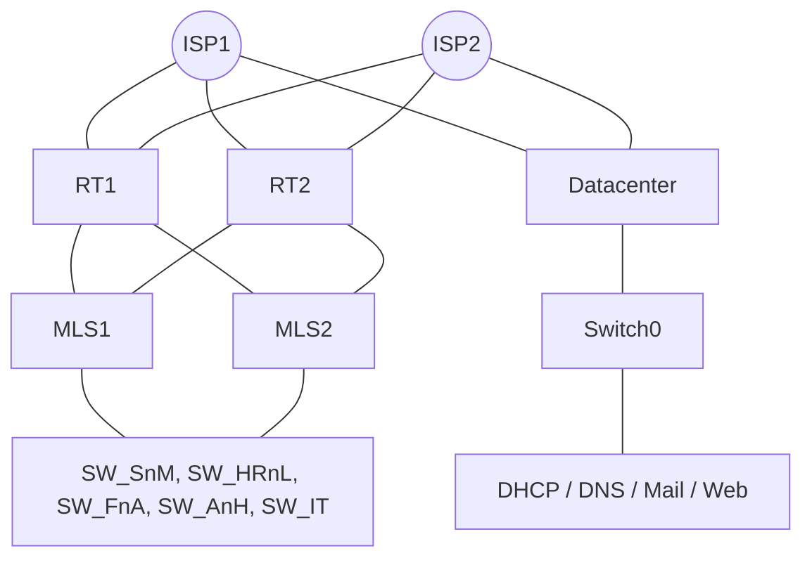

# Nagoya Campus – Dual ISP & OSPF (Cisco Packet Tracer)

Simulasi jaringan kampus dengan **dua ISP redundan**, **dua router edge**, **dua multilayer switch (inter-VLAN routing)**, dan **data center** yang terhubung ke kedua ISP. Seluruh routing menggunakan **OSPF single area (area 0)**.

- File proyek: `Nagoya campus.pkt`
- Versi Packet Tracer: 9.0

## Topologi

Setiap router edge (RT1, RT2) dan Datacenter terhubung ke **kedua** ISP, dan RT1/RT2 terhubung silang ke MLS1/MLS2, sehingga tidak ada single point of failure di jalur WAN maupun core.

## Perangkat

| Jenis | Perangkat |
|---|---|
| Router 2911 | ISP1, ISP2, RT1, RT2, Datacenter |
| Multilayer Switch 3650-24PS | MLS1, MLS2 |
| Switch 2960-24TT | SW_SnM, SW_HRnL, SW_FnA, SW_AnH, SW_IT (akses), Switch0 (data center) |
| Server | DHCP, DNS, Mail, Web |
| End device | 5 PC, 1 Laptop (wireless via Access Point) |

## Pengalamatan

### Link WAN (205.36.19.0/24, /30)

| Link | Subnet | Sisi A | Sisi B |
|---|---|---|---|
| ISP1 – RT1 | 205.36.19.0/30 | ISP1 Se0/3/0 `.1` | RT1 Se0/3/0 `.2` |
| ISP2 – RT1 | 205.36.19.4/30 | ISP2 Se0/3/1 `.5` | RT1 Se0/3/1 `.6` |
| ISP1 – RT2 | 205.36.19.8/30 | ISP1 Se0/3/1 `.9` | RT2 Se0/3/1 `.10` |
| ISP2 – RT2 | 205.36.19.12/30 | ISP2 Se0/3/0 `.13` | RT2 Se0/3/0 `.14` |
| ISP1 – Datacenter | 205.36.19.16/30 | ISP1 Se0/2/0 `.17` | DC Se0/0/0 `.18` |
| ISP2 – Datacenter | 205.36.19.20/30 | ISP2 Se0/2/0 `.21` | DC Se0/0/1 `.22` |

### Link core (10.33.2.144/28, /30)

| Link | Subnet | Sisi A | Sisi B |
|---|---|---|---|
| RT1 – MLS1 | 10.33.2.144/30 | RT1 Gi0/0 `.145` | MLS1 Gi1/0/1 `.146` |
| RT2 – MLS1 | 10.33.2.148/30 | RT2 Gi0/1 `.149` | MLS1 Gi1/0/2 `.150` |
| RT1 – MLS2 | 10.33.2.152/30 | RT1 Gi0/1 `.153` | MLS2 Gi1/0/2 `.154` |
| RT2 – MLS2 | 10.33.2.156/30 | RT2 Gi0/0 `.157` | MLS2 Gi1/0/1 `.158` |

### VLAN & subnet LAN

Gateway di SVI MLS (`ip helper-address` mengarah ke server DHCP).

| VLAN | Nama | Subnet | Gateway |
|---|---|---|---|
| 10 | SnM | 10.33.0.0/25 | 10.33.0.1 |
| 20 | HRnL | 10.33.0.128/25 | 10.33.0.129 |
| 30 | FnA | 10.33.1.0/25 | 10.33.1.1 |
| 40 | AnH | 10.33.1.128/25 | 10.33.1.129 |
| 50 | IT | 10.33.2.0/25 | 10.33.2.1 |
| 60 | Server_DC | 10.33.2.128/28 | 10.33.2.129 |

### Server (VLAN 60)

| Server | IP |
|---|---|
| DNS | 10.33.2.134 |
| DHCP | 10.33.2.135 |
| Mail | 10.33.2.137 |
| Web | 10.33.2.138 (`www.nagoya.com` di DNS) |

DHCP melayani pool per VLAN (SnM, HRnL, FnA, AnH, IT) dengan DNS 10.33.2.134.

## Konfigurasi

### Routing (OSPF process 1, area 0)

| Router | Router ID |
|---|---|
| RT1 | 1.1.1.1 |
| RT2 | 2.2.2.2 |
| MLS1 | 3.3.3.3 |
| MLS2 | 4.4.4.4 |
| ISP1 | 11.11.11.11 |
| ISP2 | 22.22.22.22 |
| Datacenter | 33.33.33.33 |

### Layer 2

- Port MLS ke switch akses: **trunk** (tiap switch akses terhubung ke MLS1 dan MLS2).
- Port ke end device: **access** sesuai VLAN masing-masing.
- Access Point terhubung ke SW_HRnL Fa0/4.
- Port security aktif di SW_FnA (Fa0/3–4) dan Switch0 (sticky MAC).

### Keamanan

- Akses remote hanya **SSH v2** (domain `nagoya.net`), login lokal.
- VTY dibatasi ACL 10 (hanya 10.33.2.0/25, yaitu VLAN IT).
- `service password-encryption` aktif.
- **Site-to-site IPsec VPN** antara RT1 (Se0/3/0) dan Datacenter (Se0/0/0): ISAKMP AES-256, pre-shared key, group 5, transform-set `esp-aes esp-sha-hmac`. Trafik yang dienkripsi: 10.33.2.128/28 (server) ↔ 10.33.0.0/24.

## Catatan / Perlu Dicek

Hal-hal yang terlihat di konfigurasi dan sebaiknya diverifikasi:

1. **IP duplikat**: Gi0/0 Datacenter (`10.33.2.129/28`) sama dengan SVI Vlan60 di MLS1 dan MLS2.
2. **SVI identik di MLS1 dan MLS2**: Vlan10–60 memakai IP yang sama di kedua MLS tanpa FHRP (HSRP/VRRP), sehingga berpotensi konflik.
3. **VPN di RT1 belum lengkap**: crypto map `VPN-MAP` tidak punya `match address`, dan ACL yang ada bernama `100` (sisi Datacenter memakai ACL `110`).
4. `ip helper-address` di Vlan60 mengarah ke `10.33.2.133`, sedangkan server DHCP berada di `10.33.2.135`.
5. VLAN 60 tidak terdaftar di VLAN database MLS, sedangkan SVI Vlan60 dibuat.
6. Beberapa pool DHCP (AnH, HRnL) memiliki end IP di luar subnet /25-nya.
7. Pre-shared key VPN dan password berada di dalam file `.pkt` yang publik. Aman untuk lab, tapi jangan dipakai ulang di jaringan nyata.

## Cara Menggunakan

1. Buka `Nagoya campus.pkt` dengan Cisco Packet Tracer 9.0 atau lebih baru.
2. Tunggu OSPF konvergen (semua link berwarna hijau).
3. Uji konektivitas, misalnya `ping` antar-VLAN, ke server, dan `nslookup www.nagoya.com`.
